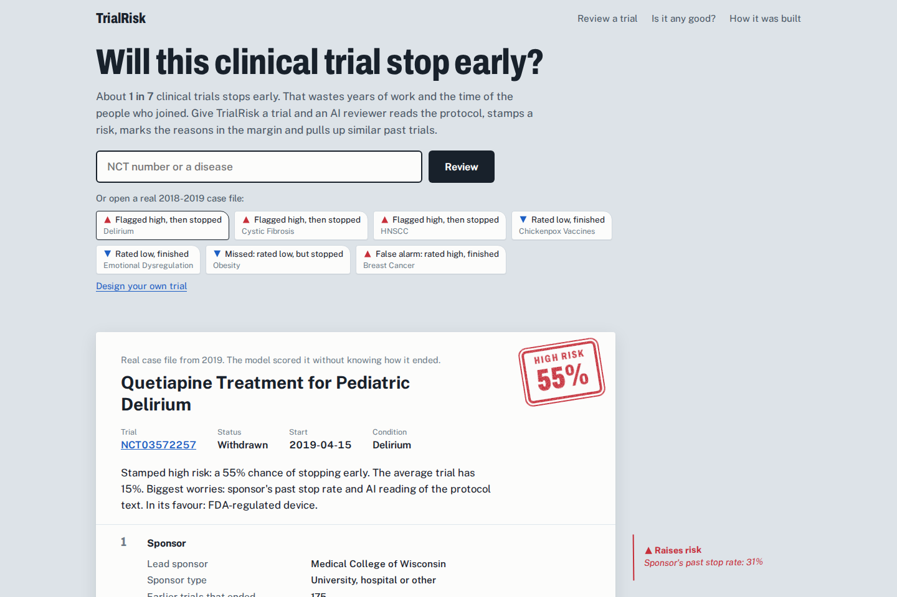

# TrialRisk: will this clinical trial stop early?

About 1 in 7 clinical trials stops early. TrialRisk reads a trial's protocol from ClinicalTrials.gov,
stamps its risk of stopping early, explains the reasons, and shows the most similar past trials.

**Live demo:** link coming soon

## Try it
- Type any trial number (NCT followed by 8 digits), or a disease to find trials recruiting now.
- Open a real 2018-2019 case file and compare the prediction with what really happened.
- Redesign the trial (phase, blinding, eligibility rules and more) and watch the risk move, or design your own trial.

## Results
Trained on trials that started in 2008-2015, calibrated on 2016-2017, and tested once on 33,788 trials that started in 2018-2019.

| Measure | Result |
|---|---|
| AUROC | 0.742 (0.770 without trials stopped by COVID-19) |
| Trials stamped high risk that really stopped | 38.6% (low risk: 7.7%) |
| Riskiest 10% of trials | stopped 2.4x more often than average |

## How it works
ClinicalTrials.gov API, DuckDB, design, eligibility and sponsor track-record features, BGE-small text embeddings (ONNX),
LightGBM tuned with Optuna and calibrated, SHAP reasons, a similar-trial search, FastAPI, a plain JavaScript website, Docker on Render.

Research demo on public ClinicalTrials.gov data. Not advice for real trial decisions.
